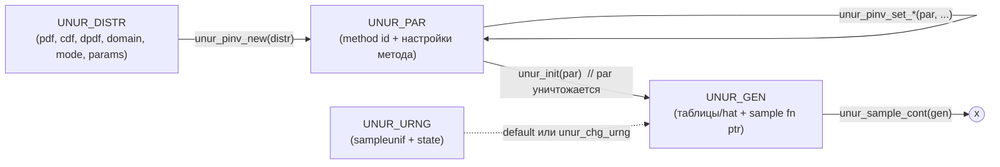
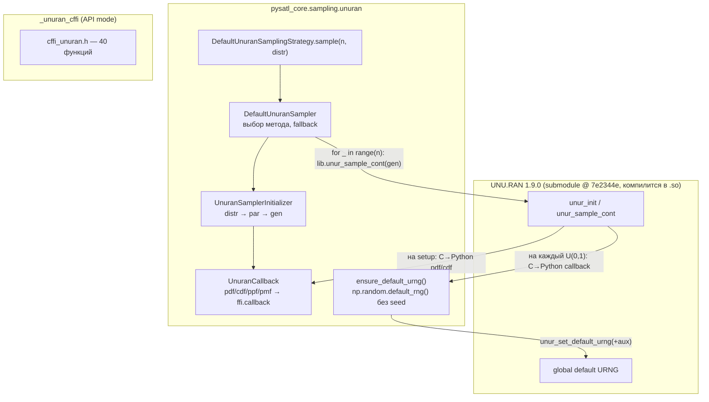

# UNU.RAN в PySATL: обзор, техдолг, интеграция с pysatl-core

Состояние на 2026-11-15. Источники — локальные клоны в `repos/`:

| Репозиторий | HEAD | Коммитов | Что это |
|---|---|---|---|
| `unuran/unuran` | `bf265291` (2026-07-03), версия **1.12.0** | 4250 | upstream, GPL-2, autotools, тесты и Texinfo-доки на месте |
| `scipy/unuran` | `7e2344e` (2026-01-08), исходники **1.9.0** | 19 | вычищенная BSD-3 копия для SciPy + `meson.build` |
| `PySATL/unuran` | `d58250b` (2026-03-02) | 23 (= scipy + 4) | наш форк: +`build_unuran.py`, переписан `get_and_clean_unuran.py`, `meson.build` собирает библиотеку |
| `PySATL/pysatl-core` | `37f7679` (2026-09-24) | 121 | MIT, Poetry + CFFI, submodule `subprojects/unuran-pysatl` |

Всё, что помечено **[проверено]**, я воспроизвёл руками (сборка, запуск, grep); **[догадка]** — вывод без прямой проверки.

---

## 1. Архитектура UNU.RAN

### 1.1 Объём

~127 тыс. строк C в `unuran/src` (без комментариев меньше, комментарии очень плотные):

| Каталог | Строк | Содержимое |
|---|---|---|
| `methods/` | 69 191 | ~40 методов генерации (PINV, TDR, AROU, HINV, NINV, DGT, DAU, SROU, HITRO, MVTDR, GIBBS, …) |
| `distributions/` | 19 678 | ~40 стандартных распределений (`c_*` — continuous, `d_*` — discrete, `vc_*` — multivariate, `m_*` — matrix) + спец. генераторы `*_gen.c` |
| `distr/` | 14 177 | объекты распределений: `cont`, `discr`, `cvec`, `cemp`, `cvemp`, `matr`, производные `corder`, `cxtrans`, `condi` |
| `parser/` | 9 700 | String API (`"normal(0,1) & method=pinv"`) и парсер функций (`"exp(-x^2/2)"`) |
| `utils/` | 6 507 | ошибки, логи, malloc-обёртки, матрицы, Lobatto-квадратура, списки, строки |
| `tests/` | 4 180 | **не unit-тесты**, а runtime-диагностика: χ², моменты, u-error, timing |
| `specfunct/` | 2 269 | Cephes: gamma, incbet, igam, ndtr, ndtri |
| `urng/` | 1 921 | абстракция uniform RNG |

Публичный заголовок `unuran.h` склеен из модульных `.h` скриптом (`scripts/merge_h.pl` в upstream): 565 объявлений, 39 конструкторов методов `unur_<method>_new`.

### 1.2 Три объекта: `distr` → `par` → `gen`



- **`struct unur_distr`** (`src/distr/distr_struct.h:204`) — tagged union по `type` (`cont`/`discr`/`cvec`/`cemp`/`cvemp`/`matr`) + vtable из двух указателей `destroy`/`clone`. Callbacks имеют сигнатуру `double f(double x, const UNUR_DISTR*)`; параметры распределения лежат внутри объекта (`set_pdfparams`), user data — через `extobj`.
- **`struct unur_par`** (`src/methods/x_gen_struct.h`) — `void *datap` на метод-специфичную структуру, `init` — указатель на функцию инициализации метода, битовая маска `set` (какие параметры заданы пользователем), `urng`, `debug`.
- **`struct unur_gen`** — `void *datap`, union указателей на sampling routine (`sample.cont/discr/cvec`), `destroy/clone/reinit/info`, private copy распределения (`distr_is_privatecopy`), вспомогательные генераторы `gen_aux`/`gen_aux_list`.

Это классический «ООП на C»: vtable руками, downcast через макросы
```c
#define GEN   ((struct unur_pinv_gen*)gen->datap)   // methods/pinv.c:507
#define DISTR gen->distr->data.cont
```
и проверка типа в runtime через `COOKIE_CHECK` (только при `UNUR_COOKIES`, в нашей сборке выключено [проверено по defines в `meson.build`]).

**Lifecycle-контракт**, на котором легко ошибиться: `unur_init(par)` **всегда** освобождает `par` — и при успехе, и при провале setup (`methods/pinv_init.h`: `gen = _unur_pinv_create(par); _unur_par_free(par); if (!gen) return NULL; ... check_par ... free(gen); return NULL`). Исключение — ранний выход при `par->method` не того типа, где `par` не освобождается. Этот контракт pysatl-core нарушает, см. §3.3.

**Один метод = один `.c` + куча «включаемых реализаций».** `methods/pinv.c` делает `#include "pinv_newset.h"`, `"pinv_init.h"`, `"pinv_sample.h"`, `"pinv_prep.h"`, `"pinv_newton.h"`… — это **C-код в файлах `.h`**: в upstream они назывались `.ch`, скрипт очистки SciPy переименовал их в `.h` (`get_and_clean_unuran.py::_ch_to_h`). Единица трансляции = весь метод; все функции `static`.

### 1.3 URNG

`struct unur_urng` (`src/urng/urng_struct.h`) — тоже vtable: `sampleunif(void*)`, `samplearray`, `setseed`, `reset`, `nextsub`, `resetsub`, `anti`, `delete` + `void *state`. В upstream есть адаптеры к GSL, PRNG, RngStreams (`src/uniform/*`). В SciPy-версии `src/uniform/` удалён целиком (там лежит `mrg31k3p.c` с чужим копирайтом, на него BSD-разрешение не распространяется), а `urng_default.c` заменён на `urng_default_mod.c`: дефолтного генератора нет, `unur_get_default_urng()` при `NULL` делает `exit(EXIT_FAILURE)` (`urng_default_mod.c:64,121`).

Глобальное состояние: `static UNUR_URNG *urng_default`, `*urng_aux_default` (`urng/urng_default.c:34-35`). Генератор копирует указатель на URNG в момент `unur_*_new`/`unur_init`, так что per-generator URNG возможен через `unur_chg_urng(gen, urng)`.

### 1.4 Ошибки

`errno`-стиль плюс глобальный callback:
- `int unur_errno` — глобальная переменная (`utils/error.c:32`), сами авторы пишут, что это не thread-safe (`utils/error.h:78-85`);
- `static UNUR_ERROR_HANDLER *_unur_error_handler` (`utils/error.c:35`), по умолчанию печатает в `static FILE *unur_stream` (`utils/stream.c:46`) — отсюда сообщения `PINV.001: [error] …` в stderr;
- функции возвращают `NULL` / `UNUR_SUCCESS` / код ошибки / `UNUR_INFINITY`; при sample ошибки часто «тихие» (возвращается `INFINITY` или значение с выставленным `unur_errno`).

Итого мутируемого глобального состояния: default URNG ×2, `unur_errno`, error handler, log stream, `_unur_default_debugflag` (`utils/debug.c:36`) + счётчики в `src/tests/*`. Генераторы между собой состояния не делят, так что «один gen на поток + свой URNG» работает, но `unur_errno` и handler всё равно общие.

### 1.5 Сборка

| | upstream | scipy/unuran | PySATL/unuran | pysatl-core |
|---|---|---|---|---|
| Система | autotools (`configure.ac`, `Makefile.am`) | `meson.build` со списками `unuran_sources`/`unuran_include_dirs`/`unuran_defines`, без target | то же + `both_libraries('unuran')` | CFFI `ffi.set_source`, **regex-парсит** `meson.build` чтобы достать список файлов (`_cffi_build.py::_extract_meson_quoted_values`) |
| `config.h` | генерирует configure | нет (defines в meson) | stub из `build_unuran.py` | генерирует `_cffi_build.py` (те же defines продублированы) |
| Тесты | `make check`: 61 `tests/t_*.conf` → Perl `make_test_files.pl` → C | удалены | удалены | своих C-тестов нет |

---

## 2. Техдолг и проблемы

### 2.1 «Objective-C» — ложная тревога **[проверено]**

В коде нет ни строки Objective-C (`grep` на `#import`, `@interface`, `@implementation` пуст). GitHub Linguist классифицирует `.h` как Objective-C по эвристике `^\s*(@(interface|class|protocol|property|end|…)\b|#import …)` из `lib/linguist/heuristics.yml`, а заголовки UNU.RAN содержат документацию в Texinfo внутри комментариев: строки вида `      @end itemize` (например `distr/cont.h:56`). 10 таких заголовков (`distr/*.h`, `parser/parser.h`, `urng/urng.h`) и дают «вкрапления Objective-C» в языковой статистике. Реальная проблема в соседнем месте: **код внутри `.h`** (бывшие `.ch`) и Texinfo-доки, размазанные по заголовкам.

### 2.2 Наш форк фактически не используется **[проверено]**

- pysatl-core пинит submodule на `7e2344e` — это **последний коммит scipy**, наши 4 коммита (`827ee98…d58250b`) в сборку pysatl-core не попадают.
- В итоге в pysatl-core собирается **UNU.RAN 1.9.0** (`unuran/configure.ac` в submodule). Upstream уже 1.12.0; между ними фиксы PINV (vanishing PDF на границе, `unur_pinv_set_extra_testpoints`), DAU.
- `PySATL/unuran/meson.build` декларирует `version: '1.11.0'`, а лежащие в репо исходники — 1.9.0. 1.11.0 появляется только если запустить `build_unuran.py`, который **скачивает tarball по plain HTTP** с `statmath.wu.ac.at` без checksum и перезаписывает `unuran/`. Это одновременно supply-chain-риск, невоспроизводимая сборка и смешение версий.
- README форка всё ещё про SciPy и 1.9.0.
- В `meson.build` `PACKAGE_VERSION` = `16:0:0` — это libtool `current:revision:age`, а не версия пакета (косметика, но `unur_get_version()`-подобные строки врут) **[догадка о последствиях]**.

### 2.3 Инфраструктура форка

Нет CI (`.github/` отсутствует), нет тестов (вычищены при очистке), нет документации (Texinfo удалён вместе с `doc/`), нет `.gitignore`/`clang-format`/sanitizers. В upstream тестовая база есть (61 конфиг + Perl-генератор) — это главный ресурс для будущего тестирования против оригинала.

### 2.4 Код: что мешает C++ напрямую

| Проблема | Где | Следствие |
|---|---|---|
| C++-ключевые слова как идентификаторы | `delete` — поле `struct unur_urng`; `new` — локальная переменная в `parser/parser.c:59`; `operator` — `parser/functparser_stringgen.h:132` | исходники нельзя просто скомпилировать как C++ (`.c` → `.cpp`) без правок |
| Код в `.h`, включаемый в один `.c` | все крупные методы (`pinv_*.h`, `tdr_*.h`, `ninv_*.h`, …) | IDE/clangd/coverage видят их плохо; ODR-ловушка, если кто-то включит дважды |
| `void *datap` + макросы-downcast | все методы | никакой проверки типов; `KNOWN-PROBLEMS`: `unur_sample_cont` на discrete-генераторе — UB/segfault |
| глобальный `unur_errno`, handler, stream | `utils/error.c`, `utils/stream.c` | не thread-safe, конфликт при нескольких потребителях в одном процессе |
| `exit()` из библиотеки | `urng_default_mod.c:64,121` | процесс Python умирает, если URNG не выставлен |
| ручное управление памятью, ownership через флаги | `distr_is_privatecopy`, «`unur_init` съедает `par`» | классический источник double free (см. 3.3) |

### 2.5 Лицензия

- upstream — GPL-2 (`COPYING`, `LICENSE`).
- SciPy-копия — BSD-3 на основании разрешения Leydold и Hörmann от 23.03.2021 (`license.txt`), **исключая** `src/uniform/mrg31k3p.c`. Разрешение дано на «UNU.RAN code»; в тексте фигурирует 1.8.1, SciPy затем обновился до 1.9.0. **Покрывает ли оно 1.10–1.12 и форк третьей стороной — из текста однозначно не следует** (вопрос научруку/авторам).
- pysatl-core — MIT. BSD-3 → MIT совместимы для линковки, но при **переводе** на C++ (derivative work) BSD-3 требует сохранить copyright notice и текст лицензии, а clause 3 запрещает использовать имена авторов/WU Wien для продвижения без разрешения — это довод в пользу переименования, но не повод выкинуть атрибуцию. Сменить лицензию целиком на MIT/Apache можно только для кода, написанного без копирования (clean-room) или с явного согласия авторов. **[это моё понимание BSD-3, не юридическая консультация]**

---

## 3. Как pysatl-core использует UNU.RAN

### 3.1 Схема



### 3.2 Что используется

- **Сборка**: Poetry build-script `src/pysatl_core/sampling/unuran/bindings/_cffi_build.py`: берёт список исходников из `subprojects/unuran-pysatl/meson.build` regex'ом, генерит `config.h`, компилирует все ~150 файлов прямо в CFFI-модуль. Ветки `find_unuran`/`_configure_from_paths` (линковка с `out/libunuran.a`, т.е. с результатом нашего `build_unuran.py`) — **мёртвый код**, `main()` их не вызывает [проверено чтением].
- **API**: `cffi_unuran.h` — 40 объявлений: `unur_distr_cont_new/discr_new`, сеттеры `pdf/dpdf/cdf/invcdf/domain/mode/pdfparams`, `pmf/cdf/pv/pmfsum/make_pv`, методы **AROU, TDR, HINV, PINV, NINV, DGT**, `unur_init`, `unur_sample_cont/discr/vec`, `unur_quantile`, free-функции, URNG, ошибки. Из 39 методов задействованы 6, `set_*` для методов не вызываются вообще (`method_params` в `UnuranMethodConfig` есть, но не пробрасываются **[проверено grep'ом по `unur_.*_set_`]**).
- **URNG**: один глобальный, `np.random.default_rng()` **без seed** (`_unuran_sampler/urng.py`), `# TODO seed support` в `initialization.py:241` → сэмплы невоспроизводимы.
- **Распределения**: только univariate (`dimension != 1` → RuntimeError). Callbacks — Python-функции характеристик из графа характеристик pysatl-core.
- **Fallback**: при RuntimeError в init — `DefaultSamplingUnivariateStrategy` (`use_fallback_sampler=True` по умолчанию).

### 3.3 Найденные дефекты

**(a) Double free при неуспешном `unur_init` [проверено, segfault].**
`_create_and_init_generator` сохраняет `self._unuran_par`, вызывает `unur_init`; при `NULL` бросает RuntimeError → `initialize_unuran_components` ловит и зовёт `cleanup()` → gen не освобождался, поэтому `gen_freed == False` → `unur_par_free(self._unuran_par)` на уже освобождённом UNU.RAN'ом `par`. Воспроизведение на собранном модуле: PINV с PDF ≡ 0 на [0, 1] → `unur_init` = NULL (`PINV.001: PDF(center) <= 0`) → `unur_par_free(par)` → **SIGSEGV (rc=139)**. `contextlib.suppress(Exception)` segfault не ловит, и до fallback дело не доходит. Причём это ровно тот путь, ради которого fallback существует. Unit-тесты не ловят, потому что 7 из 9 файлов тестов этого модуля работают через `MagicMock`/`monkeypatch` вместо реальной библиотеки. Фикс: обнулять `self._unuran_par` сразу после вызова `unur_init`, независимо от результата.

**(b) Производительность [проверено, Xeon 2.1 GHz, N = 10⁶, N(0,1) через PINV]:**

| Способ | ns / variate |
|---|---|
| pysatl-core-подобный путь (Python-цикл + C→Python URNG callback) | **837** |
| только `rng.random()` в Python-цикле | 316 |
| `scipy.stats.sampling.NumericalInversePolynomial.rvs` (тот же UNU.RAN, Cython, URNG через NumPy BitGenerator C-API, цикл в C) | **22** |
| `numpy.standard_normal` | 14 |

Разница ~38× целиком в обвязке: на каждую variate — итерация Python-генератора, CFFI-вызов `unur_sample_cont`, обратный вызов в Python за U(0,1) (`ffi.from_handle` + `Generator.random()` со scalar boxing). Сам PINV-sample — это поиск интервала + вычисление полинома Ньютона, десятки наносекунд. Setup PINV ≈ 2 мс.

**(c) Мелочи:** UNU.RAN печатает ошибки в stderr (handler не переопределён); `unur_errno` читается после неудачи, но в многопоточном коде может быть перезаписан; дублирование `config.h`-defines в двух местах; regex-парсинг `meson.build` сломается от любого рефакторинга файла.

### 3.4 Как это делает SciPy (для сравнения) **[по памяти о scipy/stats/_unuran, не перепроверял в этом проходе]**

`scipy/stats/_unuran/unuran_wrapper.pyx` (Cython) — классы `TransformedDensityRejection`, `NumericalInversePolynomial`, `NumericalInverseHermite`, `SimpleRatioUniforms`, `DiscreteAliasUrn`, `DiscreteGuideTable`; URNG строится поверх `bitgen_t` NumPy без захода в Python; `rvs(size)` заполняет массив в C-цикле; ошибки перехватываются своим error handler'ом и превращаются в Python-исключения; глобальное состояние прикрыто lock'ом. Это хороший baseline «правильной обёртки» для сравнения в ВКР.
