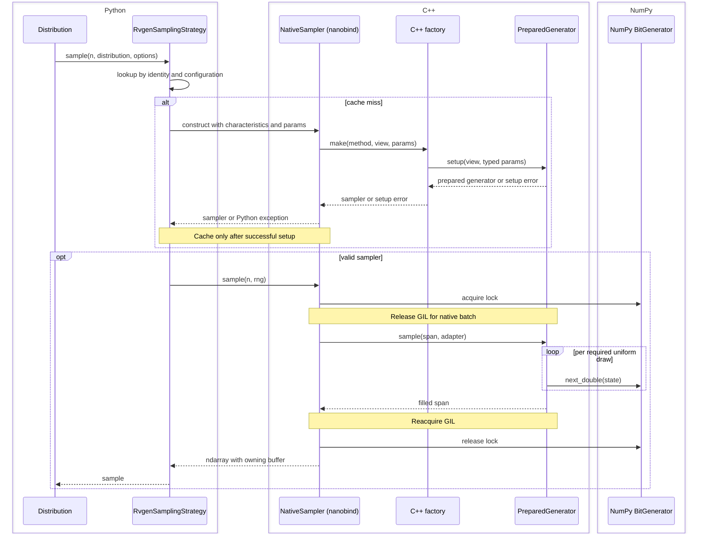

# План рефакторинга UNU.RAN для PySATL

Архитектурное дополнение к [плану CR и оценкам](03-refactoring-plan.md). Рабочее имя нового C++23-ядра — `rvgen`. В реестре целей приняты Bazel (G-001) и отказ от совместимости с C API `unur_*` (G-002). Скоуп методов, приоритет целей, nanobind и правила вывода CFFI из эксплуатации остаются предметом согласования. [Реестр целей](../refactoring-goals.xlsx), [вопросы к научруку](04-questions.md).

## 1. Исходное состояние

| Материал | Что из него следует для плана |
|---|---|
| [Обзор UNU.RAN](01-unuran-overview.md), [повестка](02-call-agenda.md), [вопросы](04-questions.md) | Изучены lifecycle `distr → par → gen`, глобальное состояние, выбор алгоритма и стоимость Python-обвязки. Вопросы по минимальному скоупу, срокам, лицензии и потребителям открыты. |
| Локальные клоны | Upstream `bf265291` (1.12.0), SciPy `7e2344e` (1.9.0), PySATL/unuran `d58250b`, pysatl-core `37f7679`. Gitlink pysatl-core указывает на `7e2344e`. В локальных деревьях есть изменения, поэтому для измерений нужны явно зафиксированные ревизия и состояние сборки. |
| [Обзор библиотек](../lib-review.pdf), §1.2 и §2, [презентация по PySATL Core](../leonid-thesis-presentation.pdf), слайды 3–4 | Пользователь расширяет набор распределений и характеристик и выбирает sampling-метод. Граф характеристик, семейства и преобразования принадлежат PySATL Core. Нативное ядро получает вычисленные характеристики либо callbacks через небольшой интерфейс. |
| [Эксперименты](../experiments/), [результаты в исходном плане](03-refactoring-plan.md#7-что-уже-проверено-для-cr-0) | Подготовлены воспроизведения double free при неуспешном setup, вызова sampling-функции с несовместимым типом и повторного использования sampler для другого распределения. Исторический замер PINV: 837 ns/variate для пути с Python callback, 198 ns с C-вызовом BitGenerator при Python-цикле, 22 ns для SciPy. Это разные пути обвязки при одном сценарии, а 22 ns — ориентир для нового ядра. |
| [C++ и Python-эскизы](../sketch/), [описание API](05-api-sketch.md) | Есть учебный TINV, эскиз DGT, адаптеры URNG, runtime-фасад и таблица с одной записью TINV. Python-расширение и strategy описаны эскизами. PINV, production differential suite и Bazel targets относятся к будущим CR. |

Локальный C++ demo собрался и выполнился с GCC 14 без sanitizers. Сборка с флагами из `sketch/build.sh` остановилась на линковке из-за отсутствия `libasan`. Численные результаты demo показывают работоспособность эскиза на его примерах.

Потребитель вызывает `Distribution.sample(n, **options)`, который делегирует работу назначенной `SamplingStrategy`. Базовая стратегия распределений в текущем коде — `DefaultSamplingUnivariateStrategy`. Feature flag в CR-4 относится к пути UNU.RAN. У выбранной UNU.RAN strategy сегодня один слот `_sampler`, хотя на вход каждого вызова приходит `distr`. Кэширование привязано к первому вызову, что объясняет ошибочную выборку при переиспользовании strategy. [Distribution](../repos/PySATL_pysatl-core/src/pysatl_core/distributions/distribution.py), [DefaultUnuranSamplingStrategy](../repos/PySATL_pysatl-core/src/pysatl_core/sampling/unuran/core/unuran_sampling_strategy.py).

## 2. Цели и критерии приёмки

Номера G1–G6 взяты из повестки. Идентификаторы G-001…G-022 принадлежат XLSX-реестру.

| Цель | Что проверять | Реестр и этап |
|---|---|---|
| G1. Сопровождаемость | Новый метод добавляется своим модулем, дескриптором и тестами. PySATL и Python binding используют прежний контракт, если новый метод укладывается в его capabilities. Проверить это на втором методе и зафиксировать затронутые файлы. | G-004, G-005, G-015, G-019, G-020 · CR-1/2/5 |
| G2. Корректность | Regression cases на setup failure, два распределения на одной strategy, ошибочные параметры и отсутствие требуемой характеристики. Differential и независимые численные свойства. Sanitizers для C++ и интеграционные тесты на собранном модуле. | G-003, G-016…G-020, G-022 · CR-0…5 |
| G3. Скорость в Python | Измерить setup и batch отдельно. Сравнить старый путь, C-batch baseline, C++ напрямую, C++ через Python и SciPy на сопоставимых условиях. Зафиксировать версию, алгоритм, точность, размер batch, RNG, ОС и toolchain. | G-003, G-007, G-011, G-021 · CR-0/3/4/8 |
| G4. Независимость | Подтвердить происхождение и разрешения для каждой переносимой ревизии. Заблокировать production-зависимость от C-oracle в Bazel. Проверить содержимое wheel и подготовить атрибуцию до публикации. | G-001, G-002, G-004, G-012, G-013 · CR-1/9 |
| G5. Расширяемость | Передать характеристики пользовательского распределения и настройки метода из PySATL. Проверить явный выбор, AUTO и диагностику отвергнутых входов. | G-007…G-010, G-013…G-015 · CR-2…7 |
| G6. Результат ВКР | Раздельно оценить вклад смены архитектуры, переноса batch-цикла и исключения Python из URNG-пути. Приложить воспроизводимый benchmark и differential corpus. | G-006, G-011, G-016, G-021 · CR-3/4/8 |

CR-0 проверяет, какую часть наблюдаемого выигрыша даёт исправленная C-обвязка. Если CR-0 достигает целей по скорости и стабильности, ценность нового ядра проверяется через G1, G4 и G5. Перенос сам по себе не даёт основания приписать выигрыш C++ или заявить новый численный алгоритм.

## 3. Целевая архитектура

### 3.1 UML-диаграмма классов

Модель описывает целевое API после CR-5. `GeneratorModel` параметризуется конкретным типом метода. `NativeSampler` обозначает объект расширения, `Sampler` — C++ runtime-фасад. Continuous и discrete ветки используют типизированные фасады с выходами `double` и целым типом соответственно. На диаграмме показана их общая структура.

```mermaid
classDiagram
    direction LR
    namespace Python {
        class Distribution {
            +sample(n, options)
        }
        class SamplingStrategy {
            <<interface>>
            +sample(n, distribution, options)
        }
        class RvgenSamplingStrategy
    }
    namespace Cpp {
        class NativeSampler {
            +sample(n, rng)
        }
        class SamplerFactory {
            +make(method, view, params) Result
        }
        class MethodDescriptor {
            +name
            +requiredCapabilities
            +create(view, params) Result
        }
        class Sampler {
            +sample(out, rng)
        }
        class GeneratorConcept {
            <<interface>>
            +sample(out, rng)
        }
        class GeneratorModel
        class PreparedGenerator {
            +sample(out, rng)
        }
        class DistributionView {
            +capabilities()
        }
        class UniformSource {
            <<interface>>
            +next_double() double
        }
        class BitGeneratorAdapter
    }
    namespace NumPy {
        class BitGenerator
    }

    Distribution --> "1" SamplingStrategy : delegates
    SamplingStrategy <|.. RvgenSamplingStrategy
    RvgenSamplingStrategy --> "0..*" NativeSampler : caches via nanobind
    NativeSampler *-- "1" Sampler : owns
    NativeSampler ..> SamplerFactory : setup
    NativeSampler ..> BitGeneratorAdapter : borrows for batch
    SamplerFactory --> "1..*" MethodDescriptor : looks up
    SamplerFactory ..> DistributionView : validates
    MethodDescriptor ..> PreparedGenerator : builds
    SamplerFactory ..> Sampler : returns
    Sampler --> "1" GeneratorConcept : shared ownership
    GeneratorConcept <|.. GeneratorModel
    GeneratorModel *-- "1" PreparedGenerator : owns
    PreparedGenerator ..> DistributionView : setup input
    PreparedGenerator ..> UniformSource : sample input
    UniformSource <|.. BitGeneratorAdapter
    BitGeneratorAdapter --> "1" BitGenerator : borrows state
```

`UniformSource` обозначает контракт C++ concept и семантику диапазона. Стрелка реализации показывает соответствие контракту, виртуальной базы в C++ здесь нет. `Sampler` владеет erased implementation через `shared_ptr<const ...>`. Заимствования показаны обычной ассоциацией или dependency. Ветка inversion с самодостаточной таблицей освобождает входное представление после setup. Для callback-зависимых методов нужно расширение контракта из §4.4.

### 3.2 UML-диаграмма rvgen(random variate generation)

Путь для PINV с готовой таблицей и `n > 0`. Диаграмма предполагает успешный захват NumPy lock и гарантированное освобождение через guard.

## 4. Паттерны и обоснование выбора

### 4.1 Strategy в PySATL, статический полиморфизм в C++ и type erasure на границе

| Решение | Отвергнутая для этой границы альтернатива | Основание и цена |
|---|---|---|
| **Strategy** на уровне `Distribution`. `RvgenSamplingStrategy` реализует уже существующий контракт. | Встраивание ветвления по backend в `Distribution.sample` или наследование отдельного класса распределения на каждый backend. | Распределение и способ выборки меняются независимо. Текущая композиция позволяет менять backend у существующего объекта. Цена — явный контракт кэша, настроек и fallback. |
| **Статический полиморфизм** внутри метода. Конкретный генератор принимает `UniformSource` как шаблонный параметр. | Виртуальный интерфейс генератора и URNG для каждой variate. | Когда тип известен, компилятор может встроить вызовы и оптимизировать цикл совместно с методом. Runtime-источник NumPy сохраняет косвенный вызов на каждое U. Цена шаблонов — инстанцирования по используемым типам URNG. |
| **Type erasure** у runtime-фасада. Один переход в erased implementation на batch. | `std::variant` со всеми типами методов либо виртуальный вызов для каждой variate. | Фасаду достаточно знать контракт batch. Добавление варианта в `variant` меняет его набор типов, а при хранении по значению размер зависит от крупнейшей альтернативы. Erasure оставляет один тип фасада и скрывает реализации. Цена — выделение памяти при создании модели, косвенный вызов на batch и shared ownership. `variant` остаётся разумным при небольшом фиксированном наборе и приоритете value storage. |

Общий `Sampler` предоставляет sampling. `quantile` — capability отдельных методов. Эскиз требует `quantile` у каждого `Model<Gen>`, поэтому перед подключением DAU или rejection этот контракт следует сузить. Типизированный inversion-генератор сохраняет прямой `quantile`. Runtime-интерфейс квантилей предоставляется для методов, которые его поддерживают.

### 4.2 Factory и явный registry

`setup(view, Params)` создаёт экземпляр с установленными инвариантами. Runtime factory разбирает имя, capabilities и параметры, затем вызывает функцию создания из дескриптора. Это фабричная функция с таблицей конструкторов. GoF Factory Method предполагал бы переопределяемый метод создания в иерархии, которая здесь избыточна.

| Альтернатива | Когда подходит | Почему выбран registry |
|---|---|---|
| `switch` по ID плюс отдельные таблицы requirements и AUTO | Два фиксированных метода и одна точка выбора | Сейчас описание метода разнесено по конфигурации, requirements, выбору и инициализации. Дескриптор объединяет имя, условия доступности и создание. Список методов и приоритет выбора проверяются тестом. |
| Саморегистрация через global constructors или plugin API | Потребитель загружает сторонние бинарные методы без пересборки ядра | Такой контракт пока отсутствует. Явная таблица детерминирована, не зависит от порядка статической инициализации или подлинковки регистратора и упрощает проверку дубликатов. Новый встроенный метод требует пересборки и одной записи в таблице. |
| Универсальный Builder для параметров | Сложный многошаговый протокол с промежуточными валидными состояниями | Здесь достаточно типизированного `Params` и атомарного `setup`. Парсер runtime-параметров должен проверять неизвестные и повторные ключи, конечность, диапазон и допустимость преобразования до cast. |

Explicit mode даёт ошибку с именем метода и недостающей характеристикой. AUTO использует фиксированный приоритет и только поддерживаемые комбинации характеристик. Порядок и допустимость перехода к следующему методу после setup failure закрепляются в parity-матрице. Наличие callback — структурное условие. Пригодность PDF, поддержка хвостов и согласованность носителя проверяются отдельно в setup.

### 4.3 Adapter и Facade на границе Python/C++

**Adapter** переводит один контракт в другой. PySATL adapter получает нужные функции от графа характеристик, а `BitGeneratorAdapter` предоставляет `next_double()` поверх пары C function pointer и state. `StdEngine` и `ReplayUrng` реализуют тот же контракт для нативных клиентов и тестов. Генератор принимает источник на вызов. Повторяемость требует того же алгоритма, параметров, начального состояния URNG и порядка обращений. Один подготовленный генератор можно использовать из нескольких потоков при глубоко неизменяемом состоянии, независимых источниках или синхронизированном разделяемом URNG.

**Facade** экспортирует создание sampler и batch sampling, скрывает registry, setup и управление буфером. Тонкая обёртка того же C API с C-batch является сильным baseline для G2/G3. Она сохраняет старый lifecycle и глобальное состояние, поэтому ограничена как способ достижения G1/G4. Перенос NumPy и Python-типов в ядро упростил бы один binding, но связал бы C++ API, тесты и алгоритмы с interpreter lifetime и GIL.

В Python API вызов `RvgenSamplingStrategy(seed=42)` создаёт один NumPy Generator на весь срок жизни strategy. Последовательные batch-вызовы продолжают этот поток. Новая strategy с тем же seed воспроизводит серию при одинаковых распределениях, настройках, версиях и порядке вызовов. При передаче готового `rng` вызывающий управляет его состоянием. Одновременная передача `rng` и `seed` в конструктор вызывает `ValueError`.

Переход в C++ один на batch. Для NumPy адаптер согласует диапазон `[0, 1)` с контрактом `(0, 1)`. Выбранную обработку нуля фиксируют в тестах, поскольку она меняет число обращений к URNG. Публичные проверки размера и параметров проходят до вызова hot path. Хватает средств RAII для lock и буфера. Передача памяти ndarray должна сохранять единственного владельца и при исключении во время создания capsule.

### 4.4 Разделение setup и sampling, владение и ошибки

| Случай | Контракт | Следствие |
|---|---|---|
| Табличные PINV, HINV, DGT и DAU | Распределение заимствуется на setup, итоговые коэффициенты и таблицы принадлежат генератору. | Python callbacks могут завершить lifetime после setup. Готовый native batch может работать без GIL. |
| NINV, TDR и AROU | Sampling может читать CDF/PDF. Требуется объект, удерживающий callback и его context до конца lifetime генератора. Для NINV определить поведение при несходимости. Для adaptive rejection определить, изменяется ли состояние во время sampling. | Освобождение GIL разрешено только для native callback и при соблюдении его контракта. Python callback требует отдельного пути с GIL. Изменяемое состояние адаптации требует локального состояния или синхронизации. |
| Ошибки | Setup возвращает `expected<Generator, SetupError>` для ошибок домена. Binding переводит диагностику в Python exception, сохраняя исходное исключение Python callback. Sampling-контракт фиксируется отдельно для каждого класса методов. | `noexcept` допустим, если это гарантируют все операции, включая URNG. Сигнатура concept проверяет тип результата, но сама по себе не гарантирует `noexcept`, валидный диапазон или завершение. |

RAII и разделение фаз — механизмы C++, а не GoF-паттерны. Ownership-флаги и ручное освобождение в нескольких ветках дают неоднозначность, которая проявилась в пути `unur_init` → `cleanup`. В целевом API владелец ресурса определён типом. Граница borrow/own нужна и для кэша. `WeakKeyDictionary` использует равенство и хеширование ключей, а обещан кэш по identity. Для CR-4 проверить контракт `Distribution`; при необходимости использовать кэш у самого объекта либо identity-ключ со weakref и защитой от повторного использования ID. Изменяемые характеристики или настройки включаются в инвалидацию. Если кэшируемый sampler удерживает callback, связанный с тем же распределением, значение кэша может удержать слабый ключ через сильную ссылку. Callback-зависимый путь требует проверки этого графа владения.

## 5. Скоуп миграции и условия переключения

| Этап | Поставка | Условие закрытия |
|---|---|---|
| CR-0 · отдельно | Hotfix legacy. Раздельно измерить C-URNG и C-batch. Исправление ownership проверять на реально собранной библиотеке. | Double free и ошибочная выборка воспроизводятся тестами до исправления и исчезают после исправления. Для legacy определить, входят ли исправление ключа кэша и проброс параметров в текущие 22–43 ч. |
| CR-1/2 · фундамент | Bazel targets и воспроизводимые входы, минимум один C++23 toolchain с нужной стандартной библиотекой, C-oracle, санитайзеры, typed API и replay harness. | Чистая сборка, smoke-wheel, unit tests, C-oracle доступен только тестам, происхождение исходников зафиксировано. До выбора 1.12.0 проверить разрешения на перенос и распространение. |
| CR-3/4 · M1 | PINV с PDF, полный путь PySATL → native batch за feature flag. | Согласованные parity-тесты, установка wheel, два разных распределения на одной strategy, empty batch, передача настроек и повторяемость с seed. PINV в CDF-режиме считать отдельно до подтверждения скоупа и ограничений. |
| CR-5 · M2 | DGT и DAU на согласованном дискретном носителе. | Проверить offset, нулевые массы, границы интервалов, dtype и выход за диапазон размеров. M2 даёт continuous + discrete пути с новым backend. |
| CR-6/7 · coverage | HINV/NINV и, при необходимости, TDR/AROU. | CDF-only и явно выбранные методы имеют согласованный маршрут. Если метод требует callback в sample, проверены lifetime, GIL и ошибки. |
| CR-8 · performance | Профилирование нативного batch и Python-границы. | Сначала профиль. SIMD оценивается при заметной доле вычислений, которые можно векторизовать с сохранением контракта точности и расхода U. |
| CR-9 · релиз | Удаление CFFI после проверки поддерживаемых сценариев, лицензии и wheel-пакетов. | Матрица ниже закрыта для всех публично обещанных сценариев. Wheel устанавливается на согласованных платформах и не содержит C-oracle. |

| Сценарий pysatl-core | Маршрут к M2 | Условие удаления CFFI |
|---|---|---|
| Continuous с PDF, PINV и AUTO | Новый PINV после проверки parity | Согласовать точность, хвосты, носитель и fallback |
| Continuous только с CDF | Сохранить согласованный маршрут к CFFI/NINV или PySATL fallback | Портировать подходящий метод либо утвердить изменение поведения |
| Continuous только с PPF | Проверить существующий fallback | Зафиксировать, кто вызывает PPF напрямую и какое поведение считается совместимым |
| Discrete с конечной таблицей вероятностей | Новый DGT, DAU отдельным явным выбором | Проверить генерацию PV и правило AUTO на поддерживаемых носителях |
| Явный HINV/NINV/TDR/AROU | Старый маршрут до решения по скоупу | Довести соответствующий порт либо согласовать deprecation/удаление опции |

Зависимость CR-9 от CR-5 и CR-6 в исходном графике — минимальная по предложенному MVP. CR-7 становится обязательным для удаления CFFI, если требуется сохранить явные TDR/AROU и согласованной альтернативы нет. Решение G-002 снимает обязательство по C ABI. Совместимость Python-опций требует отдельного решения.

## 6. Верификация и оценки

1. **Replay differential.** Закрепить версию oracle, метод, настройки, U-поток и границы носителя. Для PINV/HINV сравнивать при одинаковых предпосылках и заранее заданных допусках. Для DGT точное совпадение требует одинаковых представлений PV, tie-breaking и отображения на носитель. Отдельно проверить границы с соседними представимыми U. Для rejection проверять число U и равенство результатов лишь там, где сохранена траектория. Replay-источник в harness должен выявлять исчерпание последовательности. Учебное циклическое чтение скрывает лишние обращения и даёт UB на пустом входе.
2. **Свойства алгоритма.** Для inversion проверять монотонность, носитель и измеряемый u-error. Для непрерывной контрольной CDF $F$ на конечном наборе $U_{\mathrm{test}}$ проверяется $\max_{u\in U_{\mathrm{test}}}|F(\widehat Q(u))-u|\leq\varepsilon$. Такой тест сам по себе не устанавливает глобальную верхнюю границу. Для rejection на контрольных точках проверять $\mathrm{squeeze}\leq\mathrm{pdf}\leq\mathrm{hat}$ и отдельно обосновывать сохранение условий построения мажоранты между точками.
3. **Статистика.** Выбрать test cases, объёмы, seeds и пороги заранее. Для continuous KS использовать фиксированную непрерывную контрольную CDF, для discrete χ² проверять ожидаемые частоты по группам. Фиксировать способ учёта множественных проверок. Статистический тест дополняет численные свойства и regression cases.
4. **Контракт и интеграция.** Проверить $n=0,1$, ошибку setup и повтор после ошибки, переполнения размеров, неизвестные параметры, lifetime callbacks и NumPy-буфера, конкурентные вызовы и точный маршрут AUTO. Освобождение GIL проверяется на собранном binding, где ожидается native-only batch.

Исходные bottom-up оценки сверены с [генератором](../experiments/plan_estimate.py). При 12 ч/нед и исходном допущении о 10% запаса M1 занимает 359–639 ч с текстами, Commit до M2 — 378–674 ч, полный план — 539–958 ч. Оценки предварительные. Пересчитать после smoke-wheel и первого PINV, включив фактически согласованные Python-сценарии. Уточнить у научрука даты НИР/ВКР, подтверждённые платформы, критерии выпуска и скоуп rejection. [Декомпозиция и календарь](03-refactoring-plan.md), [открытые вопросы](04-questions.md).
