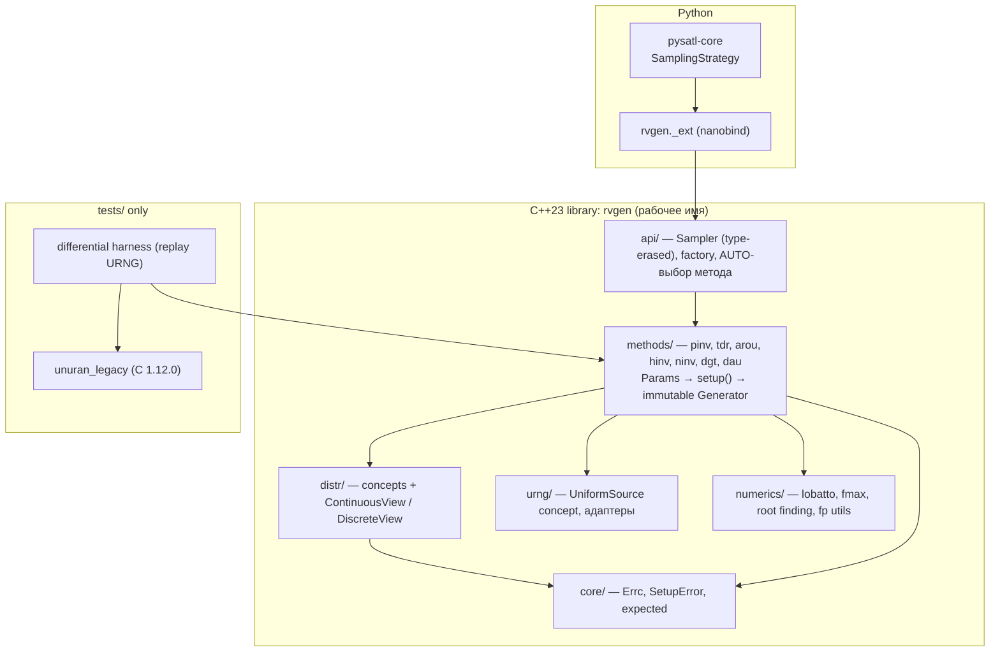
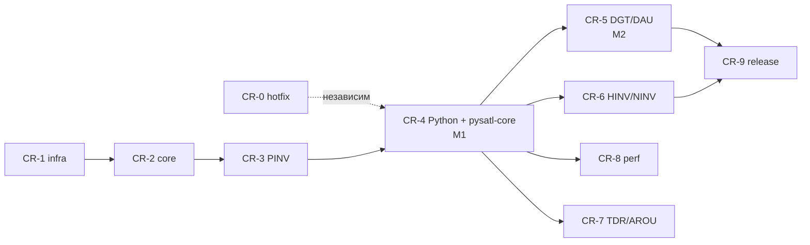
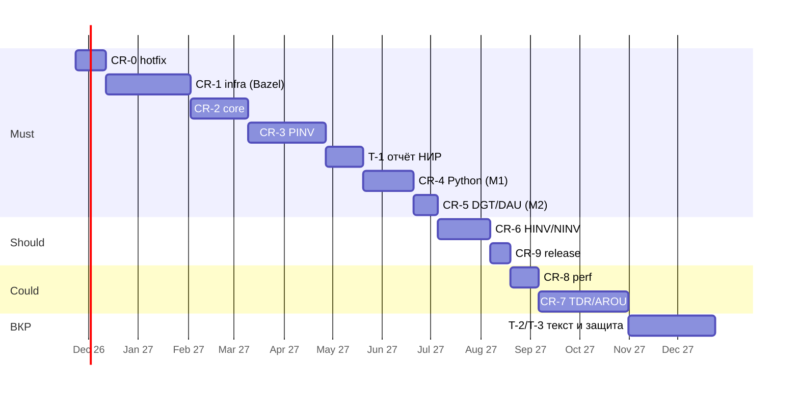

# План рефакторинга UNU.RAN → C++23: архитектура, ADR, CR и оценки

Черновик от 2026-11-15 (ред. 2: build system — Bazel, совместимость с legacy API не требуется — решения пользователя), основан на [01-unuran-overview.md](01-unuran-overview.md) и [02-call-agenda.md](02-call-agenda.md). Здесь заранее приняты решения, которые на созвоне ещё могут поменяться. Если цели окажутся другими, ADR пересматриваются, а CR-декомпозиция в основном сохраняется.

## 0. Допущения, на которых стоят оценки

| # | Допущение | Если неверно |
|---|---|---|
| A1 | Исполнитель один, уровень C++ профессиональный, в численных методах RVG пока новичок | ×0.7 по часам при опыте в RVG, ×1.3 при двух людях на ревью/синхронизацию (Brooks) |
| A2 | Стратегия D (гибрид): новое ядро только для методов, которые нужны pysatl-core (PINV, TDR, AROU, HINV, NINV, DGT) и DAU; C-оригинал остаётся oracle'ом в тестах | при полном rewrite ~40 методов умножать на ~3–4 |
| A3 | **Решено:** совместимость с C API `unur_*` не нужна. Следствие: String API и function parser не портируются, имена/сигнатуры/семантика параметров проектируются заново | — |
| A4 | Только univariate. Multivariate (`cvec`, MVTDR, HITRO, GIBBS) вне скоупа | +100–200 ч **[грубая догадка]** |
| A5 | Темп 12 ч/неделю, без учёта сессий и каникул | календарь масштабируется линейно |
| A6 | Оценка «часы на задачу» включает тесты и ревью-итерации, но **не** включает текст НИР/ВКР (он идёт отдельной строкой) | — |

### Как получены часы

Это bottom-up оценка по задачам, откалиброванная на объёме кода. SLOC я считал без комментариев и пустых строк (`gcc -fpreprocessed -E -P`, upstream 1.12.0):

| Метод | SLOC всего | из них debug/info | Что портировать | Часы (CR) | SLOC/ч |
|---|---|---|---|---|---|
| PINV | 1 712 | 243 | ~1 470 | 61–104 (CR-3) | 14–24 (первый метод: учёба + harness) |
| TDR | 3 475 | 682 + GW-вариант ~700 | ~2 100 (PS+IA) | ≈ 46–78 из CR-7 | 27–46 |
| AROU | 1 367 | — | ~1 200 | ≈ 24–42 из CR-7 | 29–50 |
| HINV + NINV | 981 + 1 208 | ~180 у NINV | ~2 000 | 42–70 (CR-6) | 29–48 |
| DGT + DAU | 408 + 367 | — | ~700 | 18–32 (CR-5) | 22–39 |
| Всего: 7 методов | 9 518 | | ~7 500 | 191–326 | |

Для сравнения: весь `methods/` занимает 27 159 SLOC, `distr/` 5 107, `distributions/` 9 066, `parser/` 2 910. На старте PINV заложен в 1.5–2 раза медленнее по SLOC/ч, чем остальные методы: на нём выстраиваются harness, URNG и distr-слой. **После CR-3 оценки надо перекалибровать**: умножить оставшиеся CR на отношение факт/план по CR-3. Если PINV уложится в 104 ч и выше, а темп на последующих методах не вырастет, к CR-5…CR-7 надо добавить ещё ~30%.

---

## 1. Целевая архитектура

### 1.1 Слои



Правило зависимостей: зависимости только сверху вниз, циклов нет, `legacy` никогда не линкуется в продуктовые target'ы. Это проверяет сам Bazel: у `//third_party/unuran_legacy` стоит `testonly = True` и `visibility = ["//tests:__subpackages__"]`, поэтому зависимость продуктового target'а от него — ошибка анализа, а не договорённость.

### 1.2 Ключевые абстракции (эскиз API)

```cpp
// distr: что метод требует от распределения — compile-time
template <class D>
concept ContinuousDensity = requires(const D& d, double x) {
    { d.pdf(x) } -> std::convertible_to<double>;
};
// runtime-представление для Python-callback'ов и единственного инстанса метода
class ContinuousView;          // fn-ptr + void* ctx на pdf/dpdf/cdf/logpdf, domain, mode, area — всё optional

// urng: генератор передаётся при вызове, а не хранится в объекте
template <class G>
concept UniformSource = requires(G& g) { { g.next_double() } -> std::same_as<double>; }; // U ∈ (0,1)

namespace pinv {
struct Params { int order = 5; double u_resolution = 1e-10; /* ... */ };
class Generator {                                     // immutable после setup
public:
    static std::expected<Generator, SetupError> setup(const ContinuousView&, const Params& = {});
    template <UniformSource G> double operator()(G& g) const noexcept;
    template <UniformSource G> void   sample(std::span<double> out, G& g) const noexcept;
    double quantile(double u) const noexcept;         // PINV/HINV/NINV: approx. inverse CDF
};
}
```

Из чего следуют свойства:
- **Thread safety по построению.** `Generator` const и не держит URNG, поэтому один генератор безопасно сэмплить из N потоков, каждый со своим URNG. В C-версии это невозможно: там глобальные `unur_errno`, handler и default URNG.
- **Ownership без флагов.** Таблицы лежат в `std::vector`, copy и move по умолчанию (rule of zero). Нет ни `distr_is_privatecopy`, ни контракта «`unur_init` съедает `par`», то есть класс багов вроде double free из 01 §3.3 исчезает.
- **Ошибки.** Только в setup: `std::expected<Generator, SetupError>`, где `SetupError` хранит `Errc` и диагностику (какое условие нарушено и в какой точке). В `sample` ошибок нет, потому что инварианты гарантирует setup. Python-слой переводит `SetupError` в исключение.
- **Неверный тип распределения становится ошибкой компиляции**, а не UB из `KNOWN-PROBLEMS`: у `pinv::Generator` нет `sample_discr`.

### 1.3 Структура репозитория

```
rvgen/
  MODULE.bazel  MODULE.bazel.lock  .bazelversion  .bazelrc  BUILD.bazel
  pyproject.toml  setup.py        # PEP 517 backend, вызывает bazel build //python:_ext
  rvgen/                          # один Bazel-пакет на слой, visibility по правилу зависимостей
    core/  urng/  distr/  numerics/  methods/{pinv,dgt,...}/  api/   # BUILD.bazel + .h + .cpp
  python/                         # nanobind_extension + pure-Python обёртка, .pyi
  tests/{unit,differential,statistical}/
  third_party/unuran_legacy/      # UNU.RAN 1.12.0 C (BSD-часть), testonly
  bench/  docs/ (adr/, user/, dev/)  .github/workflows/
  LICENSE  NOTICE (атрибуция UNU.RAN, BSD-3)
```

---

## 2. ADR

### ADR-001: Стратегия миграции

**Status:** Proposed. **Deciders:** научрук, команда PySATL.

**Context.** Upstream содержит 127k строк C и ~40 методов, pysatl-core использует 6 из них. Срок ограничен НИР+ВКР, исполнитель один. Нужны работающий продукт на каждом этапе и защищаемая новизна.

| Вариант | Сложность | Срок до пользы для pysatl-core | Новизна для ВКР | Риск недоделать |
|---|---|---|---|---|
| A. Обёртка над C | Low | 2–4 недели | Low | Low |
| B. Strangler по всем методам | High | после первого метода | Med | High (скоуп ~40 методов) |
| C. Rewrite с нуля, без oracle | High | поздно | High | High (нет эталона) |
| **D. Гибрид: новое ядро на 7 методов + oracle** | Med | после CR-4 | Med–High | Med |

**Decision.** D. Обёртку (A) фактически реализует CR-0 как быстрый выигрыш на старом C, после чего C остаётся только в тестах.

**Consequences.** Проще: на каждом шаге есть эталон, а скоуп режется по методам без перепроектирования. Сложнее: до CR-9 живут две реализации. Пересмотреть, если научрук захочет полный охват методов или multivariate.

### ADR-002: Модель sampling API: URNG передаётся при вызове

| Критерий | URNG передаётся в `operator()(G&)` (как `std::normal_distribution`) | URNG хранится в генераторе (как UNU.RAN) |
|---|---|---|
| Thread safety | генератор const, шарится свободно | нужна копия генератора на поток |
| Воспроизводимость | явная, видна в сигнатуре | неявная |
| Hot path | шаблон, inline, без косвенного вызова | один косвенный вызов на U |
| Python-фасад | хранит пару (Generator, BitGenerator) | естественнее |
| Type erasure | нужен для runtime URNG: `sample(span, AnyUniform&)` с одним виртуальным вызовом на batch | — |

**Decision.** Передавать при вызове. Python-фасад `Sampler` хранит `shared_ptr<const Generator>` и NumPy `BitGenerator`, URNG берётся через `bitgen_t*`, без Python в hot path.

### ADR-003: Представление распределения на границе метода

**Context.** Setup методов вызывает pdf/cdf тысячи раз, а rejection-методы (TDR, AROU) вызывают pdf и в sample, при отказе squeeze-теста. Источник callback'ов чаще всего Python: стоимость его вызова порядка сотен ns против ~1–3 ns на косвенный вызов в C++.

| Вариант | Code bloat / compile time | Скорость pdf | Python-callback |
|---|---|---|---|
| Метод — шаблон по `D` | ×(число распределений) | inline | всё равно нужен type-erased `D` |
| **`ContinuousView` (fn-ptr + ctx)** | один инстанс | +1 косвенный вызов | естественно |
| `std::function` | один инстанс | +1 косвенный вызов, возможна аллокация | естественно |

**Decision.** Сделать `ContinuousView` (non-owning, похож на `function_ref` из C++26) и owning-обёртку для Python. Template-fast-path оставить на CR-8, если профайлер покажет, что вызов pdf в sample TDR заметен **[не измерено: долю вызовов pdf в sample TDR ещё надо замерить]**.

### ADR-004: Build system — Bazel, биндинги — nanobind

**Status:** Accepted (build system выбран пользователем 2026-11-15). **Биндинги:** Proposed.

**Decision.** Bazel (LTS через Bazelisk, bzlmod) как единственная система сборки для C++-ядра, legacy-oracle, Python-расширения, тестов и бенчмарков. Биндинги — nanobind через `nanobind_bazel`.

**Обоснование: где Bazel объективно сильнее CMake** (формулировки для бизнес-обоснования в тексте работы):

| Свойство | Bazel | CMake (+ ccache, CTest, FetchContent/vcpkg) | Что это даёт проекту |
|---|---|---|---|
| Hermeticity | sandbox на каждое действие, необъявленный header/файл — ошибка сборки; toolchain и зависимости закреплены в `MODULE.bazel` + lockfile с integrity-хэшами | сборка зависит от окружения хоста; pinning — дисциплина, а не механизм | воспроизводимость результатов ВКР и релизов; закрывает найденную в форке проблему «tarball по HTTP без checksum» (01 §2.2) на уровне инструмента |
| Корректность инкрементальности | граф действий, ключ кэша = хэш всех входов, флагов и toolchain | timestamps; ccache кэширует только компиляцию | нет класса ошибок «помог только clean build» |
| Кэш результатов тестов | `bazel test` перезапускает только тесты, чьи входы изменились; remote cache делит это между CI и разработчиками | CTest всегда гоняет всё (или ручные labels) | главный денежный аргумент: статистические и differential-тесты на $N = 10^6$ дорогие, а правка в одном методе не трогает остальные |
| Архитектурные границы | `visibility` и `testonly` проверяются при анализе | нет эквивалента; target виден всем | слои из §1.1 и запрет линковать GPL-происхождением legacy-oracle в продукт соблюдаются автоматически |
| Один граф на все языки | C++, C, Python-расширение, Python-тесты, wheel — одна команда `bazel test //...` | CMake + scikit-build-core + pytest + скрипты-склейки | меньше несогласованных конфигураций (ровно та проблема, что сейчас в pysatl-core: defines продублированы в meson и в `_cffi_build.py`) |
| Конфигурации | `--config=asan/tsan/opt`, выходы разных конфигураций не смешиваются | отдельные build-директории и presets | sanitizers и бенчмарки как рутинные команды |
| Анализ влияния | `bazel query 'rdeps(//..., //rvgen/numerics:lobatto)'` | нет штатного | точный ответ «какие тесты затронуты PR» |
| Масштабирование | рассчитан на monorepo и remote execution | деградирует на больших графах | запас, если PySATL сведёт компоненты в один репозиторий |

**Цена решения (честно, без неё обоснование не выдержит вопросов на защите):**

| Слабое место Bazel | Последствие | Митигация |
|---|---|---|
| Python wheels: `scikit-build-core` и `meson-python` — готовые PEP 517 backend'ы, у Bazel такого нет | свой backend, вызывающий `bazel build`, плюс cibuildwheel; sdist требует Bazel у пользователя | образец есть: google/benchmark собирает wheels именно так (`setup.py` + `nanobind_bazel` + cibuildwheel) **[проверено: `setup.py` в main]**; публиковать wheels под все платформы, sdist считать запасным путём |
| Windows | Bazel на Windows исторически самый проблемный target (пути, symlinks, MSVC toolchain) **[по опыту сообщества, сам не проверял на этом проекте]** | hermetic LLVM есть только для Linux/macOS; на Windows — системный MSVC; заложено в 1.2/1.3 |
| Потребители C++-библиотеки ждут `find_package`/CMake | внешний C++-пользователь без Bazel не подключит | основной потребитель — Python wheel; для C++ — публикация модуля в Bazel Central Registry; минимальный `CMakeLists.txt` можно добавить позже, если появится запрос |
| IDE/clangd | нет `compile_commands.json` из коробки | extractor-инструмент: `hedron_compile_commands` в BCR отсутствует **[проверено]**, подключается через `git_override`; его статус сопровождения **нужно проверить** перед выбором (задача 1.8) |
| Порог входа для контрибьюторов из научного Python | SciPy/NumPy на Meson, Bazel знают немногие | короткий dev-guide; `bazelisk` как единственная зависимость |
| Время на освоение | ≈ +20…+46 ч к плану против CMake-варианта (CR-1: +14…+34, CR-4: +6…+12) | окупается, если тестовый набор тяжёлый и CI гоняется часто; **на проекте одного человека с малым кодом выигрыш в скорости сборки сам по себе мал** — основная ценность здесь в hermeticity, visibility и кэше тестов |

Наличие нужных модулей в BCR **[проверено 2026-11-15 по `metadata.json`]**: `rules_cc`, `rules_python`, `nanobind_bazel`, `googletest`, `google_benchmark`, `catch2`, `toolchains_llvm`. Версию Bazel фиксировать на актуальной LTS; работать только через bzlmod (`MODULE.bazel`), без `WORKSPACE`.

**Биндинги.**

| | **nanobind** (`nanobind_bazel`) | pybind11 (`pybind11_bazel`) | оставить CFFI |
|---|---|---|---|
| C++-типы в Python (RAII, ndarray, исключения) | да, компактный бинарь, ndarray без копий, stable ABI | да, бинарь больше | нет: нужен `extern "C"`-слой |
| Поддержка в Bazel | есть в BCR | есть в BCR | вручную |

**Consequences.** Проще: воспроизводимость, контроль слоёв, селективный прогон тестов. Сложнее: packaging wheels и Windows. Пересмотреть, если packaging на Windows съест больше верхней границы 4.2 (28 ч): запасной вариант — собирать wheel для Windows отдельным минимальным CMake/setuptools-путём.

### ADR-005: Методика верификации (differential testing)

**Context.** Вычисленный результат нужно сравнивать с оригиналом, проверить «на глаз» нельзя.

**Decision.** Три уровня:
1. **Replay-differential.** `ReplayUrng` подаёт одну и ту же последовательность U в C-legacy и C++. Inversion-методы (PINV, HINV, NINV, DGT) — детерминированные функции U, поэтому проверяется $|x_{C} - x_{C++}| \le \varepsilon$, а для дискретных методов точное равенство. Для rejection-методов проверяется равное число потреблённых U и совпадение x, если порядок вычислений сохранён.
2. **Свойства метода.** Для inversion: u-error $\max_u |F(F_a^{-1}(u)) - u| \le$ `u_resolution` (так u-error определяет сам UNU.RAN, см. `tests/inverror.c`). Для rejection: проверка $\text{squeeze} \le \text{pdf} \le \text{hat}$ на сетке.
3. **Статистика.** χ² / KS на $N = 10^6$ с фиксированным seed. Порог по p-value надо выбирать с поправкой на множественные проверки, иначе CI будет flaky.

**Риск, который стоит назвать заранее.** Bit-exact между C и C++ не гарантирован из-за FP contraction (FMA). На arm64 (Apple Silicon) компилятор может сливать `a*b+c` в FMA, и тогда младшие биты отличаются. Differential-сборки делать с `-ffp-contract=off` у обеих сторон. Точные дефолты `-ffp-contract` для GCC, Clang и Apple Clang **нужно свериться с документацией компиляторов**, по памяти не утверждаю.

---

## 3. Change Requests

CR — единица, которая мержится и сама по себе приносит пользу. Внутри CR задачи примерно соответствуют PR. Часы даны диапазоном «оптимистично–пессимистично» (A1–A6).

### CR-0. Hotfix pysatl-core на текущем C

Зависит от: —

| # | Задача | Часы | После |
|---|---|---|---|
| 0.1 | Fix double free `par` + интеграционный тест на реальной .so (не MagicMock) | 3–5 | — |
| 0.2 | URNG через NumPy `BitGenerator.cffi.next_double` из C (без Python-callback), per-sampler URNG через `unur_chg_urng` | 4–8 | — |
| 0.3 | Seed / `np.random.Generator` в API `UnuranMethodConfig`/strategy | 3–6 | 0.2 |
| 0.4 | Batch: C-helper `sample_n(gen, double*, n)` в `set_source`, убрать Python-цикл | 3–6 | — |
| 0.5 | Обновить vendored UNU.RAN до 1.12.0 в PySATL/unuran, закоммитить исходники, убрать HTTP-download, перевести submodule на наш HEAD | 5–10 | — |
| 0.6 | Бенчмарк до/после + PR, review-итерации | 4–8 | 0.1, 0.2, 0.3, 0.4, 0.5 |
| | **Итого CR-0** | **22–43** | |

### CR-1. Инфраструктура нового репо (Bazel)

Зависит от: —

| # | Задача | Часы | После |
|---|---|---|---|
| 1.1 | Скелет репо: Bazel LTS через Bazelisk (`.bazelversion`), bzlmod (`MODULE.bazel` + lockfile), `.bazelrc` с configs (opt/dbg/asan/ubsan/tsan), C++23 copts, пакеты и `visibility` по слоям; clang-format, pre-commit, buildifier | 12–22 | — |
| 1.2 | Toolchains: hermetic LLVM (`toolchains_llvm`) для Linux/macOS, MSVC на Windows; проверка нужных C++23 library features на всех трёх | 6–14 | 1.1 |
| 1.3 | CI matrix Linux/macOS arm64/Windows: `bazel test //...`, disk/repository cache в GitHub Actions (`bazel-contrib/setup-bazel`) | 10–20 | 1.2 |
| 1.4 | Sanitizers как `--config=asan|ubsan`, coverage через `bazel coverage` (lcov → Codecov) | 5–10 | 1.3 |
| 1.5 | `//third_party/unuran_legacy`: C 1.12.0 как `cc_library(testonly = True)` с `visibility` только на `//tests` (oracle) | 5–10 | 1.1 |
| 1.6 | Тест-фреймворк (GoogleTest или Catch2 из BCR) + differential harness: replay-URNG, запуск C и C++ на одном U-потоке | 10–18 | 1.5 |
| 1.7 | Benchmark harness (`google_benchmark` из BCR), сравнение с legacy, артефакты в CI | 4–8 | 1.5 |
| 1.8 | Dev experience: `compile_commands.json` для clangd/clang-tidy (extractor — выбрать и проверить, см. ADR-004), инструкция для CLion/VS Code | 4–10 | 1.1 |
| 1.9 | Docs skeleton (Doxygen + Sphinx/Breathe или MkDocs), ADR-каталог | 3–6 | 1.1 |
| | **Итого CR-1** | **59–118** | |

### CR-2. Core: ошибки, URNG, distr, numerics

Зависит от: CR-1

| # | Задача | Часы | После |
|---|---|---|---|
| 2.1 | Error model: `enum class Errc`, `SetupError` с диагностикой, `std::expected`; ноль глобального состояния | 4–8 | — |
| 2.2 | URNG: concept поверх `std::uniform_random_bit_generator` + `UniformSource` (double в (0,1)); адаптеры std-engine, NumPy bitgen, Replay/Counting для тестов | 6–12 | — |
| 2.3 | Distribution: concept для compile-time + type-erased `ContinuousView`/`DiscreteView` (fn ptr + ctx) с опциональными характеристиками, domain, mode, area | 12–20 | 2.1 |
| 2.4 | Numerics: adaptive Gauss-Lobatto (`utils/lobatto`), поиск максимума (`utils/fmax`), root finding, FP-утилиты (`unur_fp`): порт + unit-тесты | 14–24 | 2.1 |
| 2.5 | Набор эталонных распределений для тестов (normal, gamma, beta, expon, cauchy, truncated, multimodal, vanishing-PDF) + генератор тест-кейсов из upstream `tests/t_*.conf` | 8–14 | 2.3 |
| | **Итого CR-2** | **44–78** | |

### CR-3. PINV end-to-end (первый метод)

Зависит от: CR-2

| # | Задача | Часы | После |
|---|---|---|---|
| 3.1 | Чтение статьи Derflinger–Hörmann–Leydold (ACM TOMACS 2010) и `pinv_*.ch`, схема алгоритма | 8–12 | — |
| 3.2 | Setup: поиск границ/обрезка хвостов (`pinv_prep`), CDF-таблицы на Lobatto, Newton-интерполяция (`pinv_newton`), оценка u-error | 30–50 | 3.1 |
| 3.3 | Sample + guide table, batch `sample(span, urng)` | 4–8 | 3.2 |
| 3.4 | Тесты: differential vs legacy (разность x_C и x_C++ при одном U-потоке), u-error ≤ заданного, edge cases (truncated, vanishing PDF, heavy tails, n=0/1) | 16–28 | 3.3 |
| 3.5 | Бенчмарк setup/sample vs legacy и SciPy | 3–6 | 3.3 |
| | **Итого CR-3** | **61–104** | |

### CR-4. Python bindings + интеграция в pysatl-core

Зависит от: CR-3

| # | Задача | Часы | После |
|---|---|---|---|
| 4.1 | nanobind-модуль (`nanobind_extension`): `Sampler`, NumPy ndarray out без копий, Python-callback → `ContinuousView`, освобождение GIL на batch | 14–24 | — |
| 4.2 | Packaging: `nanobind_bazel` + PEP 517 backend, вызывающий Bazel (образец: `setup.py` в google/benchmark), cibuildwheel Linux/macOS/Windows, repair (auditwheel/delocate/delvewheel); sdist требует Bazel у пользователя | 14–28 | 4.1 |
| 4.3 | pysatl-core: новая strategy за feature flag, parity-тесты против CFFI-пути, переключение default | 12–20 | 4.2 |
| | **Итого CR-4** | **40–72** | |

### CR-5. Discrete: DGT + DAU

Зависит от: CR-4

| # | Задача | Часы | После |
|---|---|---|---|
| 5.1 | DGT (guide table) порт + тесты | 6–10 | — |
| 5.2 | DAU (alias-urn) порт + тесты | 6–10 | — |
| 5.3 | `DiscreteView`, PV/PMF-входы, биндинги, подключение в pysatl-core | 6–12 | 5.1, 5.2 |
| | **Итого CR-5** | **18–32** | |

### CR-6. HINV + NINV

Зависит от: CR-4

| # | Задача | Часы | После |
|---|---|---|---|
| 6.1 | HINV (Hermite interpolation, Hörmann–Leydold 2003) порт | 16–26 | — |
| 6.2 | NINV (Newton / regula falsi / bisection, опц. таблица стартовых точек) порт | 14–24 | — |
| 6.3 | Тесты (differential + u-error), биндинги | 12–20 | 6.1, 6.2 |
| | **Итого CR-6** | **42–70** | |

### CR-7. TDR + AROU (rejection, stretch)

Зависит от: CR-4

| # | Задача | Часы | После |
|---|---|---|---|
| 7.1 | TDR: общий setup (точки построения, hat/squeeze, adaptive rejection), варианты PS (default) и IA; GW не портировать | 36–60 | — |
| 7.2 | AROU порт | 18–32 | — |
| 7.3 | Тесты: replay-exact где совпадает порядок U, иначе χ²/KS + проверка hat ≥ pdf ≥ squeeze; биндинги | 16–28 | 7.1, 7.2 |
| | **Итого CR-7** | **70–120** | |

### CR-8. Performance

Зависит от: CR-4

| # | Задача | Часы | После |
|---|---|---|---|
| 8.1 | Профилирование (perf/Instruments), устранение аллокаций/ветвлений в hot path | 6–12 | — |
| 8.2 | Векторизация batch-пути PINV/DGT (autovectorization или xsimd/Highway), замер vs scalar | 10–20 | 8.1 |
| 8.3 | Отчёт: таблица C vs C++ vs SciPy vs NumPy по методам | 4–8 | 8.2 |
| | **Итого CR-8** | **20–40** | |

### CR-9. Релиз, лицензия, имя, удаление CFFI

Зависит от: CR-5, CR-6

| # | Задача | Часы | После |
|---|---|---|---|
| 9.1 | Удалить CFFI-биндинги и submodule из pysatl-core, deprecation | 4–8 | — |
| 9.2 | LICENSE/NOTICE с атрибуцией UNU.RAN, переименование, README, user guide | 6–12 | — |
| 9.3 | Release 0.1 на PyPI/TestPyPI, changelog | 4–8 | 9.1, 9.2 |
| | **Итого CR-9** | **14–28** | |


---

## 4. Сводка и скоуп

| CR | Суть | Часы | Середина | Тип |
|---|---|---|---|---|
| CR-0 | Hotfix pysatl-core на C | 22–43 | 32 | must, независим |
| CR-1 | Инфраструктура (Bazel) | 59–118 | 88 | must |
| CR-2 | Core | 44–78 | 61 | must |
| CR-3 | PINV | 61–104 | 82 | must |
| CR-4 | Python + pysatl-core | 40–72 | 56 | must (milestone **M1**) |
| CR-5 | DGT + DAU | 18–32 | 25 | must (**M2**: замена CFFI по continuous+discrete) |
| CR-6 | HINV + NINV | 42–70 | 56 | should |
| CR-9 | Релиз, лицензия, имя | 14–28 | 21 | should |
| CR-8 | Performance | 20–40 | 30 | could (сильный материал для ВКР) |
| CR-7 | TDR + AROU | 70–120 | 95 | could / stretch |
| T-1…T-3 | Тексты НИР, ВКР, презентация | 100–166 | 133 | must |

| Скоуп | Инженерия | + тексты | + 10% на коммуникацию и непредвиденное | Недель при 12 ч/нед |
|---|---|---|---|---|
| M1: CR-0…4 | 226–415 | 326–581 | **359–639** | 30–53 |
| Commit: CR-0…5 | 244–447 | 344–613 | **378–674** | 32–56 |
| MVP: CR-0…6 + CR-9 | 300–545 | 400–711 | **440–782** | 37–65 |
| Full: все CR | 390–705 | 490–871 | **539–958** | 45–80 |

Относительно редакции 1 (CMake) Bazel добавил 20–46 ч: CR-1 45–84 → 59–118, CR-4 34–60 → 40–72.

Проверка арифметики: таблицы задач сгенерированы скриптом (`experiments/plan_estimate.py`), суммы посчитаны им же. Выборочная проверка руками: CR-1 = 12+6+10+5+5+10+4+4+3 = 59 и 22+14+20+10+10+18+8+10+6 = 118; CR-4 = 14+14+12 = 40 и 24+28+20 = 72, совпадает.

**Рекомендация.** Обязательный объём — Commit (CR-0…5). Это заменяет текущие CFFI-биндинги на новое ядро для continuous (PINV) и discrete (DGT/DAU), то есть даёт законченный продукт. CR-6/CR-9 — плановое продолжение. CR-7 и CR-8 — по остатку времени. Из них CR-8 дешевле и даёт больше измеримых результатов для защиты, поэтому делать его раньше CR-7. Исключение: если научруку принципиально нужны TDR/AROU (rejection — отдельный класс алгоритмов и другая методика тестирования).

## 5. Последовательность и календарь

Исполнитель один, поэтому критический путь — почти вся цепочка. Параллелить можно только CR-0 с CR-1 (разные репо) и тексты с ожиданием ревью.



Календарь по серединам оценок, 12 ч/нед, старт 2026-11-23, сессии и каникулы не учтены:



Вывод: при 12 ч/нед M2 достигается к началу июля 2027, полный скоуп с текстом — к концу декабря 2027. Если ВКР защищается весной/летом 2027, скоуп надо резать до Commit, а текст писать параллельно с CR-4/5. **Сроки НИР и ВКР — первое, что нужно узнать на созвоне**, без них календарь условный.

## 6. Риски

| Риск | Вероятность | Влияние | Митигация |
|---|---|---|---|
| Численные edge cases, которые UNU.RAN годами отлаживал (vanishing PDF, хвосты, почти вырожденные интервалы), теряются при порте | High | High | Differential на upstream-тест-кейсах (`tests/t_*.conf`), u-error как инвариант, портировать «как есть» и рефакторить уже под тестами |
| PINV занимает >104 ч (кривая обучения) | Med | High | Перекалибровка после CR-3 и урезание скоупа по таблице §4 |
| FP-различия C vs C++ (FMA, порядок суммирования) ломают bit-exact | Med | Low–Med | `-ffp-contract=off` в differential-сборках, допуск в ulp/u-error |
| Windows: Bazel + MSVC + C++23 + сборка wheel съедают время | Med–High | Med | MSVC в matrix с CR-1, временно `continue-on-error`; заранее проверить нужные library features; запасной путь сборки Windows-wheel (ADR-004) |
| Bazel-packaging wheels сложнее оценки | Med | Med | Спайк на 4–6 ч в начале CR-1: пустой `nanobind_extension` → wheel → `pip install` на трёх ОС, до того как писать ядро |
| Лицензионный статус форка не прояснён | Low–Med | High (блокирует релиз) | Письмо авторам UNU.RAN до CR-9; NOTICE с атрибуцией с первого коммита |
| Конфликт API с ожиданиями команды pysatl-core | Med | Med | Согласовать Python API на CR-4 до реализации (короткий design review) |

## 7. Что уже проверено для CR-0

На собранном модуле pysatl-core (Xeon 2.1 GHz, PINV, N(0,1), $N = 10^6$):

| Вариант | ns / variate |
|---|---|
| Как сейчас: Python-цикл + Python URNG callback | 837 |
| Python-цикл + URNG = `PCG64.cffi.next_double` напрямую из C | **198** |
| SciPy `NumericalInversePolynomial.rvs` (цикл в C) | 22 |

`numpy.random.BitGenerator.cffi` отдаёт `next_double` с сигнатурой `double(void*)` и `state_address` — это ровно сигнатура `unur_urng_new(double (*)(void*), void*)`, поэтому задача 0.2 — несколько строк. Скрипт: `experiments/bench_bitgen_urng.py`. Оставшиеся ~180 ns — это Python-цикл и CFFI-вызов на каждую variate, их убирает задача 0.4 (batch в C). Ожидаю выход на уровень SciPy, порядка десятков ns **[не измерено]**. Lifetime: `BitGenerator` должен жить не меньше генератора UNU.RAN, его нужно держать ссылкой в Python-объекте sampler'а.

## 8. Вопросы, которые влияют на этот план

Закрыто пользователем: build system — Bazel; совместимость с legacy API не нужна.

1. Сроки НИР и ВКР, и сколько часов в неделю реально (A5).
2. Скоуп методов: устраивает ли Commit/MVP, нужны ли TDR/AROU и multivariate (A2, A4).
3. Делать ли CR-0 сразу отдельными PR в pysatl-core, и кто ревьюит.
