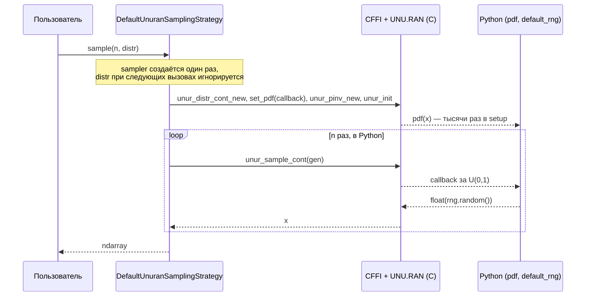
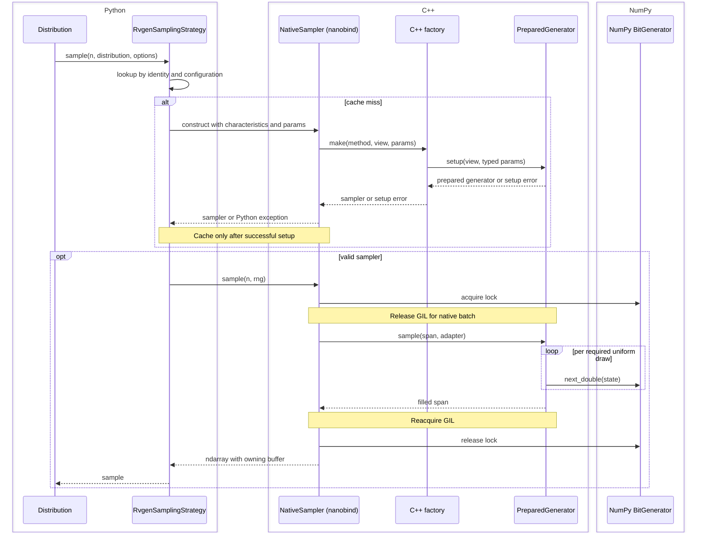

# Эскиз API нового ядра и его работа с pysatl-core

Контракты API для [целевой архитектуры и плана миграции](03-refactoring%20plans.md). UML показывает целевой API к M2. Примеры C++ отражают текущий [прототип](../sketch/), рабочее имя ядра — `rvgen`.

**Статус кода.** Это эскиз, а не реализация.

| Часть | Файлы | Состояние |
|---|---|---|
| C++-ядро | `sketch/rvgen/**`, `sketch/examples/demo.cpp` | собрано GCC 13.3 с `-Wall -Wextra -Wpedantic -Wconversion -Wshadow` и ASan+UBSan, пример отработал |
| Python-модуль | `sketch/python/ext.cpp` | **не собирался**, сигнатуры nanobind нужно сверить с документацией |
| Стратегия для pysatl-core | `sketch/python/pysatl_strategy.py` | семантика seed проверена с NumPy и тестовой заменой Sampler; интеграция с native extension пока не проверена |

Метод `tinv` в эскизе учебный: трапеции и линейная интерполяция. Он показывает форму метода, на его месте будет PINV с тем же интерфейсом. `dgt` реализован по-настоящему, он маленький.

---

## 1. Карта абстракций

```mermaid
classDiagram
    direction LR
    namespace Python {
        class Distribution {
            +sample(n, options)
        }
        class SamplingStrategy {
            <<interface>>
            +sample(n, distribution, options)
        }
        class RvgenSamplingStrategy
    }
    namespace Cpp {
        class NativeSampler {
            +sample(n, rng)
        }
        class SamplerFactory {
            +make(method, view, params) Result
        }
        class MethodDescriptor {
            +name
            +requiredCapabilities
            +create(view, params) Result
        }
        class Sampler {
            +sample(out, rng)
        }
        class GeneratorConcept {
            <<interface>>
            +sample(out, rng)
        }
        class GeneratorModel
        class PreparedGenerator {
            +sample(out, rng)
        }
        class DistributionView {
            +capabilities()
        }
        class UniformSource {
            <<interface>>
            +next_double() double
        }
        class BitGeneratorAdapter
    }
    namespace NumPy {
        class BitGenerator
    }

    Distribution --> "1" SamplingStrategy : delegates
    SamplingStrategy <|.. RvgenSamplingStrategy
    RvgenSamplingStrategy --> "0..*" NativeSampler : caches via nanobind
    NativeSampler *-- "1" Sampler : owns
    NativeSampler ..> SamplerFactory : setup
    NativeSampler ..> BitGeneratorAdapter : borrows for batch
    SamplerFactory --> "1..*" MethodDescriptor : looks up
    SamplerFactory ..> DistributionView : validates
    MethodDescriptor ..> PreparedGenerator : builds
    SamplerFactory ..> Sampler : returns
    Sampler --> "1" GeneratorConcept : shared ownership
    GeneratorConcept <|.. GeneratorModel
    GeneratorModel *-- "1" PreparedGenerator : owns
    PreparedGenerator ..> DistributionView : setup input
    PreparedGenerator ..> UniformSource : sample input
    UniformSource <|.. BitGeneratorAdapter
    BitGeneratorAdapter --> "1" BitGenerator : borrows state
```



В Python роль `NativeSampler` выполняет экспортируемый класс `Sampler`. В C++ роль `SamplerFactory` выполняет функция `make_continuous`, роль `MethodDescriptor` — запись `ContinuousMethod`. Фасад `ContinuousSampler` хранит `shared_ptr<const Concept>`. Конкретный `Model<Gen>` владеет подготовленным `Gen` по значению. Роли `DistributionView` и `BitGeneratorAdapter` в continuous-пути выполняют `ContinuousView` и `FnUrng`. Дискретному пути в целевой модели соответствует отдельный фасад с целочисленным выходом.

| Абстракция | Файл | Роль | Что заменяет в UNU.RAN |
|---|---|---|---|
| `Errc`, `SetupError`, `Result<T>` | `core/error.hpp` | ошибка как значение, только в setup | глобальный `unur_errno`, error handler, `exit()` |
| `UniformSource` + адаптеры | `urng/uniform_source.hpp` | источник U ∈ (0,1), передаётся при вызове | `struct unur_urng`, глобальный default URNG |
| `ContinuousDensity`, `ContinuousView`, `Cap` | `distr/continuous_view.hpp` | контракт распределения и его runtime-представление | `struct unur_distr` (union из шести видов) |
| `<method>::Params` | `methods/*.hpp` | параметры метода, обычный aggregate | `UNUR_PAR` и функции `unur_<m>_set_*` |
| `<method>::Generator` | `methods/*.hpp` | результат setup: неизменяемые таблицы + алгоритм выборки | `UNUR_GEN` с `void* datap` и макросами-downcast |
| `ContinuousSampler`, registry | `api/sampler.hpp` | выбор метода строкой во время выполнения | `unur_init` через указатель `par->init`, String API |

## 2. Ошибки: `core/error.hpp`

```cpp
enum class Errc { invalid_param, unknown_param, unknown_method, missing_capability,
                  invalid_density, density_vanishes, invalid_pv };
struct SetupError { Errc code; std::string what; };

template <class T>
using Result = std::expected<T, SetupError>;
```

При ошибке параметров или распределения factory возвращает `SetupError`. Binding проверяет `Result` до публикации sampler и переводит ошибку в `ValueError`. Исключение из Python callback передаётся вызывающему. Для готовой таблицы корректный URNG и доступный выходной буфер достаточны для выборки. Методы с вычислением CDF/PDF во время sampling требуют собственного контракта ошибок.

**Связь с найденным дефектом.** Случай «PDF ≡ 0», который сейчас роняет pysatl-core по SIGSEGV, здесь возвращает `Errc::density_vanishes`. Вывод примера: `has_value=false error='tinv: integral of pdf over the domain is 0'`.

**Альтернатива.** Исключения из setup. Проще для вызывающего, но тип ошибки не виден в сигнатуре. Trade-off: если ядро будет использоваться только из Python, разница мала.

## 3. Источник равномерных чисел: `urng/uniform_source.hpp`

```cpp
template <class G>
concept UniformSource = requires(G& g) {
    { g.next_double() } -> std::same_as<double>;   // U из открытого (0, 1)
};

template <std::uniform_random_bit_generator E> class StdEngine;  // над std::mt19937_64 и т.п.
struct FnUrng { double (*fn)(void*); void* state; };             // граница с C и NumPy
class ReplayUrng;                                                // заданная последовательность, для тестов
```

**Идея.** Генератор не хранит источник случайности. Источник приходит аргументом в `sample`, как в `std::normal_distribution::operator()(Generator&)`.

**Следствия.**
- Подготовленную неизменяемую таблицу можно разделять между потоками, если каждый поток использует собственный URNG и выходной буфер. В примере четыре потока сэмплят из одного генератора без блокировок, ThreadSanitizer-прогон не делал, ASan/UBSan чисто.
- Воспроизводимость видна в сигнатуре: какой источник передан, такой и результат.
- `ReplayUrng` даёт основу для сравнения с C-оригиналом: один и тот же поток U подаётся в обе реализации.

**Три адаптера и зачем каждый.**

| Адаптер | Применение | Деталь |
|---|---|---|
| `StdEngine<E>` | C++-пользователи, тесты | берёт 52 старших бита: $(k + 0.5) \cdot 2^{-52}$, $k \in [0, 2^{52})$ |
| `FnUrng` | Python: пара `bitgen_t::next_double` и `bitgen_t::state` из NumPy | NumPy даёт $[0, 1)$, ноль отбрасывается |
| `ReplayUrng` | differential-тесты | — |

**Открытый интервал — требование, а не украшение.** Inversion считает $F^{-1}(u)$; при $u = 0$ или $u = 1$ получается граница носителя, для нормального распределения это $\pm\infty$.

**Про 52 бита.** Первый вариант брал 53 бита и формулу $(k + 0.5) \cdot 2^{-53}$. Он неверен: при $k \ge 2^{52}$ число $k + 0.5$ не представимо в `double` (шаг сетки на $[2^{52}, 2^{53})$ равен 1) и при округлении к чётному может стать $2^{53}$, что даёт ровно 1.0. С 52 битами $k + 0.5 < 2^{52}$ представимо точно, диапазон $[2^{-53},\, 1 - 2^{-53}]$. Границы зафиксированы `static_assert`'ами в заголовке.

## 4. Распределение: `distr/continuous_view.hpp`

Два уровня: compile-time контракт и runtime-представление.

```cpp
template <class D>
concept ContinuousDensity = requires(const D& d, double x) {
    { d.pdf(x) } -> std::convertible_to<double>;      // обязателен только pdf
};
// опционально: HasCdf, HasDpdf, HasDomain, HasMode

class ContinuousView {                                 // невладеющий, type-erased
public:
    using Fn = double (*)(const void* ctx, double x);
    template <ContinuousDensity D> static ContinuousView of(const D& d) noexcept;
    template <ContinuousDensity D> static ContinuousView of(const D&&) = delete;
    double pdf(double x) const;
    Cap capabilities() const noexcept;                 // pdf | cdf | dpdf | mode | finite_domain
    // cdf, dpdf, domain, mode, with_cdf, with_domain ...
};
```

Пользовательское распределение — обычная структура без базового класса:

```cpp
struct TruncatedNormal {
    double mu, sigma, lo, hi;
    double pdf(double x) const { const double z = (x - mu) / sigma; return std::exp(-0.5 * z * z); }
    Interval domain() const { return {lo, hi}; }
};
auto gen = tinv::Generator::setup(ContinuousView::of(distr), {.intervals = 4096});
```

**Зачем нужен `ContinuousView`, если есть concept.** Метод можно было бы сделать шаблоном по типу распределения. Тогда код метода (у PINV это ~1 500 строк) инстанцируется заново для каждого типа, а для Python-callback'ов type-erased обёртка всё равно нужна. `ContinuousView` даёт один экземпляр кода метода ценой одного косвенного вызова на вычисление плотности. Для табличного PINV плотность вызывается только в setup, поэтому в выборке эта цена нулевая.

**`Cap` — механизм расширяемости.** Распределение сообщает, что умеет. Метод объявляет, что требует (`tinv::required = Cap::pdf | Cap::finite_domain`). Соответствие проверяется одной битовой операцией. Новое распределение не трогает методы, новый метод не трогает распределения.

**Время жизни.** View не владеет объектом. Перегрузка для rvalue удалена, чтобы `ContinuousView::of(TruncatedNormal{...})` не компилировалось: иначе указатель на временный объект повис бы сразу после выражения.

**Callbacks после setup.** TINV и табличный PINV сохраняют готовые таблицы. NINV вычисляет CDF во время sampling, а TDR и AROU могут обращаться к PDF. Для таких методов генератор должен удерживать владельца callback и его context до последнего вызова. Вызов Python callback требует GIL. Этот путь предстоит реализовать отдельно.

## 5. Метод: `methods/tinv.hpp`, `methods/dgt.hpp`

Каждый метод — пространство имён с тремя сущностями.

```cpp
namespace rvgen::tinv {
inline constexpr Cap required = Cap::pdf | Cap::finite_domain;

struct Params { std::size_t intervals = 1024; };

class Generator {
public:
    static Result<Generator> setup(const ContinuousView& d, const Params& p = {});

    double quantile(double u) const noexcept;
    template <UniformSource G> double operator()(G& urng) const;
    template <UniformSource G> void sample(std::span<double> out, G& urng) const;
private:
    double lo_, h_;
    std::vector<double> cdf_;      // rule of zero
};
}
```

**Соответствие паттернам** (из обсуждения в треде): `setup` — фабрика, `Params` — parameter object вместо Builder'а, `Generator` — неизменяемый продукт и function object.

**Что исчезает по сравнению с C.**

| В UNU.RAN | Здесь |
|---|---|
| `par = unur_pinv_new(d); unur_pinv_set_order(par, 5); gen = unur_init(par);` и правило «`unur_init` освобождает `par`» | `pinv::Generator::setup(view, {.order = 5})`, владение очевидно |
| `void* datap` + `#define GEN ((struct unur_pinv_gen*)gen->datap)` | обычные поля класса |
| флаг `distr_is_privatecopy`, ручные `free` | `std::vector`, деструктор по умолчанию |
| `unur_sample_cont` на дискретном генераторе: UB (`KNOWN-PROBLEMS`) | `dgt::Generator::sample` принимает `span<int64_t>`, передать `span<double>` — ошибка компиляции |

**Batch-интерфейс `sample(span, urng)`** — главный путь для Python: цикл целиком в C++, один вызов на всю выборку.

## 6. Runtime-слой: `api/sampler.hpp`

Нужен, когда метод выбирается строкой: из Python или конфига.

```cpp
class ContinuousSampler {                     // shared_ptr<const Concept> внутри
public:
    template <class Gen> explicit ContinuousSampler(Gen gen);
    void sample(std::span<double> out, FnUrng urng) const;    // один виртуальный вызов на batch
    double quantile(double u) const;
};

struct ContinuousMethod {
    std::string_view name;
    Cap required;
    Result<ContinuousSampler> (*make)(const ContinuousView&, ParamList);
};
inline constexpr std::array continuous_methods{
    ContinuousMethod{"tinv", tinv::required, &detail::make_tinv},
    // ContinuousMethod{"pinv", pinv::required, &detail::make_pinv},
};

Result<ContinuousSampler> make_continuous(std::string_view method, const ContinuousView&, ParamList = {});
```

**Type erasure.** В прототипе модель требует и `sample`, и `quantile`. В целевом API общий фасад требует только batch sampling, а `quantile` доступен как отдельная capability для поддерживающих его методов. Это позволяет подключить DAU и rejection-методы. Виртуальный вызов выполняется один раз на batch, затем конкретный генератор заполняет переданный span.

**Registry.** `"auto"` выбирает первый метод из таблицы, чьи требования покрываются возможностями распределения. Опечатка в имени параметра даёт `Errc::unknown_param`, а не молчаливое игнорирование (сейчас в pysatl-core `method_params` не используются вовсе).

**Как добавить метод.**
1. Новый файл `methods/<m>.hpp`: `required`, `Params`, `Generator` с `setup`, `quantile` (для inversion), `sample`.
2. Функция `detail::make_<m>`: разбор `ParamList` в `Params`.
3. Одна строка в `continuous_methods`.
4. Тесты: differential против C-оригинала и свойства метода.

Распределения, биндинги и pysatl-core при этом не меняются: новый метод становится доступен из Python по имени.

---

## 7. Взаимодействие с pysatl-core

### 7.1 Как сейчас



На каждую variate приходится итерация Python-цикла, вызов через CFFI и обратный вызов в Python. Замер: 837 ns на variate.

### 7.2 Как будет



Диаграмма описывает PINV при $n>0$. На cache hit strategy сразу переходит к выборке. При cache miss запись появляется только после успешного setup. Если конструктор выбросил исключение, запись отсутствует и batch не запускается. При следующем вызове setup можно повторить.

Binding выделяет выходной буфер и захватывает lock конкретного BitGenerator. Внутри этой области он отпускает GIL и передаёт C++ заимствованный span. При выходе, включая исключение, binding сначала восстанавливает GIL, затем освобождает lock. При успехе владение буфером переходит к ndarray. Для этого табличного пути равномерные числа берутся прямым вызовом C-функции NumPy. Ожидаемый порядок скорости — как у SciPy на том же алгоритме (22 ns на variate в моём замере), для нового ядра это ещё **не измерено**.

### 7.3 Код со стороны Python

```python
class RvgenSamplingStrategy:
    def __init__(self, method="auto", rng=None, *, seed=None, **params):
        if seed is not None and rng is not None:
            raise ValueError("Specify either seed or rng")
        self._method, self._params = method, params
        self._rng = rng if rng is not None else np.random.default_rng(seed)
        self._cache = weakref.WeakKeyDictionary()          # distr -> Sampler

    def sample(self, n, distr, **options):
        if n < 0:
            raise ValueError("Sample size must be non-negative")
        sampler = self._cache.get(distr)
        if sampler is None:
            pdf = distr.query_method("pdf")
            sampler = Sampler(pdf=lambda x: float(pdf(x)),
                              lo=float(distr.support.left), hi=float(distr.support.right),
                              method=self._method, **self._params)
            self._cache[distr] = sampler
        return sampler.sample(n, options.get("rng", self._rng))
```

```python
# Использование:
from pysatl_core.families.configuration import configure_families_register
from pysatl_core.types import FamilyName
from pysatl_strategy import RvgenSamplingStrategy

normal = configure_families_register().get(FamilyName.NORMAL)
strategy = RvgenSamplingStrategy(method="pinv", seed=42)
distribution = normal(mu=0.0, sigma=1.0).with_sampling_strategy(strategy)

samples = distribution.sample(10_000)

///////////////


strategy1 = RvgenSamplingStrategy(method="pinv", params = dynamic_seed / static_seed)

# strategy2 = RvgenSamplingStrategy(method="pinv")

distribution1 = normal(mu=0.0, sigma=1.0).with_sampling_strategy(strategy1)

samples1 = distribution1.sample(10_000)
 

distribution2 = normal(mu=0.0, sigma=1.0).with_sampling_strategy(strategy1)
samples2 = distribution2.sample(10_000)


### golden_samples1 - input data
### golden_samples2 - input data

assert(samples1 != samples2) # Ok
assert(golden_samples1 == samples1) 
assert(golden_samples2 == samples2)

```

Конструктор с `seed=42` создаёт один RNG на всё время жизни strategy. Последовательные batch продолжают один поток. Новая strategy с тем же seed воспроизводит серию при тех же методе, параметрах, версиях и порядке вызовов. Опция `rng` отдельного вызова временно подставляет переданный источник. Seed и состояние RNG не входят в ключ кэша таблиц PINV.

Ключ в целевой модели учитывает identity распределения и настройки setup. Сокращённый пример предполагает фиксированные параметры strategy и неизменные характеристики распределения. Для изменяемых характеристик нужна инвалидация или версия в ключе. Использование `WeakKeyDictionary` требует проверки семантики равенства и хеширования ключа.

### 7.4 Что меняется в pysatl-core

| Сейчас (`sampling/unuran/`) | Станет |
|---|---|
| `bindings/_cffi_build.py`, `cffi_unuran.h`, submodule с C-исходниками | зависимость от wheel-пакета |
| `core/_unuran_sampler/initialization.py` (ручной lifecycle `distr`/`par`/`gen`, место double free) | конструктор `Sampler`, владение в C++ |
| `core/_unuran_sampler/callbacks.py` | одна лямбда вокруг `query_method("pdf")` |
| `core/_unuran_sampler/urng.py` (глобальный URNG без seed) | `rng` передаётся аргументом |
| `core/method_requirements.py` (таблица требований, расходится с UNU.RAN для HINV) | требования живут в ядре рядом с методом, единственный источник |
| `core/unuran_sampler.py::_select_best_method` | `method="auto"` в ядре |
| стратегия с одним закэшированным sampler'ом | кэш по распределению |

Переход на wheel и удаление CFFI завершают миграцию после проверки покрытия CDF-only и явно выбранных методов. На M1 новый путь включается для PINV, M2 добавляет DGT и DAU. Скорость native batch предстоит измерить на собранном binding.

### 7.5 Что нужно уточнить у команды pysatl-core

- Поддерживает ли `Distribution` слабые ссылки и хэширование по identity. Если нет, кэш переносится в сам объект распределения.
- Как получить границы носителя и что делать с бесконечными. Учебный `tinv` требует конечный домен; PINV сам находит точки отсечения хвостов, ему бесконечные границы допустимы.
- Вызов `pdf` из C++ по одной точке стоит сотни наносекунд на вызов. Если setup окажется узким местом, в `ContinuousView` добавляется пакетный вариант: C++ передаёт массив точек, Python считает плотность векторно за один вызов. В эскизе этого нет.
- Для выбранной версии binding проверить конкурентное использование общего BitGenerator и освобождение lock при исключениях.

---

## 8. Что всплыло при сборке эскиза

Полезно как материал для выбора минимальных версий компиляторов.

| Наблюдение | Следствие |
|---|---|
| В GCC 13.3 нет заголовка `<print>` | либо минимальный GCC 14, либо `std::format` + свой вывод (в примере сделано так) |
| Clang 18 с libstdc++ 13 не видит `std::expected` | проверено сборкой; причина, по моей памяти, в проверке макроса `__cpp_concepts` внутри libstdc++, сам не перепроверил. Нужна связка Clang + libc++ или более новый Clang |
| Аргументы вызова функции вычисляются в неопределённом порядке ([expr.call]) | в первой версии примера три вызова `gen(urng)` в одном `println` дали значения в обратном порядке; в тестах с `ReplayUrng` каждое значение брать в отдельную переменную |
| 53-битная формула для U давала бы 1.0 | см. раздел 3, исправлено до 52 бит |

## 9. Чего в эскизе нет

- PINV и остальные настоящие continuous-методы.
- Владение распределением для rejection-методов (раздел 4).
- Runtime-слой и registry для дискретных методов (`DiscreteSampler`): устроен так же, как `ContinuousSampler`.
- Пакетное вычисление плотности.
- Сборка через Bazel: в `sketch/` только `build.sh` для одного примера.
